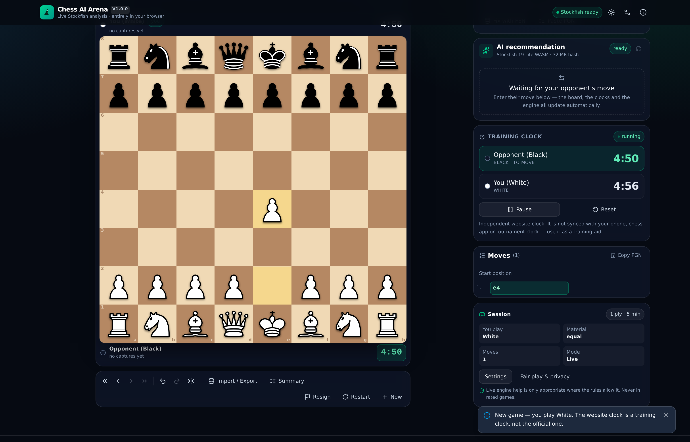
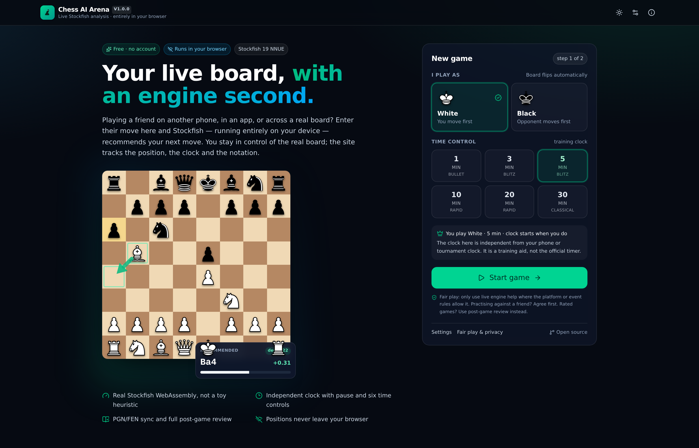
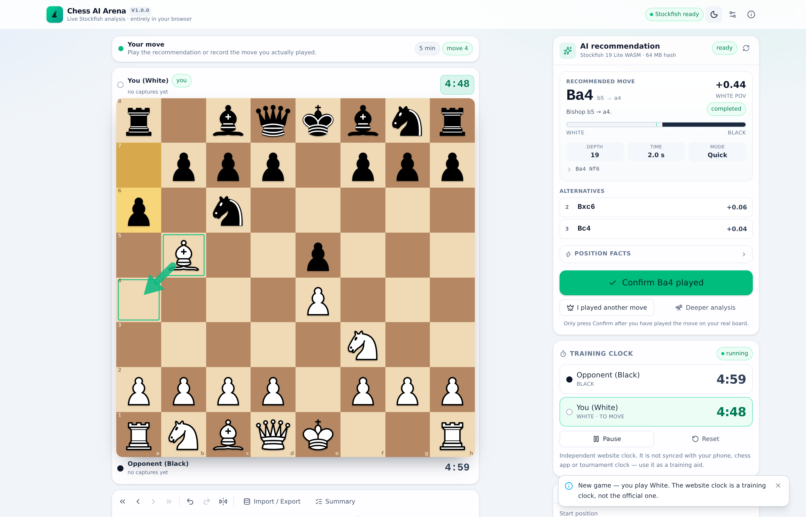
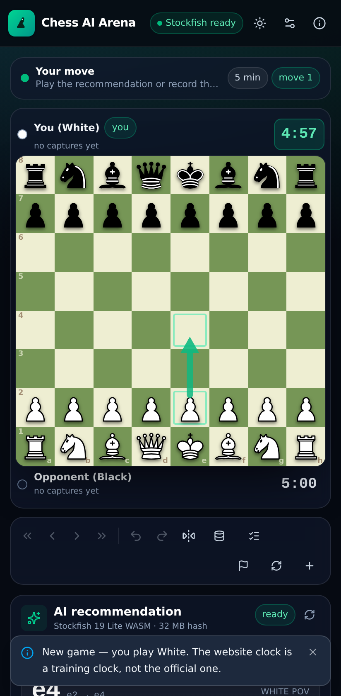

# Chess AI Arena

A free, private, browser-only chess assistant for playing **on a real board against a
human opponent**. You enter their moves, Stockfish suggests your reply in the browser,
and you confirm what you actually played.

No account. No backend. No analytics. No paid service. Everything — including the
engine — runs locally in your browser tab.



> **Fair play first.** Live engine assistance is cheating in rated over-the-board games,
> online rated games and most tournaments. Use this only for casual or training games
> where the rules allow it, and use the post-game review to study afterwards. There is no
> "guaranteed win" here: Stockfish gives good moves, not certain ones.

---

## Contents

- [What it does](#what-it-does)
- [Screens](#screens)
- [Requirements](#requirements)
- [Quick start](#quick-start)
- [Scripts](#scripts)
- [Deploying to GitHub Pages](#deploying-to-github-pages)
- [Testing](#testing)
- [How it works](#how-it-works)
- [Offline support](#offline-support)
- [Data, privacy and storage](#data-privacy-and-storage)
- [Troubleshooting](#troubleshooting)
- [Known limitations](#known-limitations)
- [Licensing](#licensing)
- [Acknowledgements](#acknowledgements)

---

## What it does

**Start screen**

- Pick your colour. The board flips automatically if you play Black, and the app knows
  that White moves first — so you are never asked to move twice in a row.
- Six independent clocks: 1, 3, 5, 10, 20 or 30 minutes.
- Starting a game resets the board, move list, clocks and analysis, and boots the engine.
- If an unfinished game is stored, you are asked whether to resume it before a new one
  replaces it.

**Board**

- 8×8 board with click-to-move *and* drag-and-drop, legal-move dots and rings, capture
  hints, last-move highlight, check and checkmate highlights, coordinate labels.
- Promotion picker, captured-piece trays and material balance for both sides.
- Orientation follows your colour; a flip button is available for review.
- Responsive from small phones (tested at 320 px wide) to desktop.

**Recording moves**

- Enter the **opponent's** move by clicking two squares or by typing notation.
- SAN is the default (`Nf3`, `O-O`, `exd5`, `e8=Q+`); UCI (`g1f3`) is available when you
  explicitly select it.
- Ambiguous input such as `Nf` or `R1e2` is disambiguated or reported clearly.
- Illegal moves, out-of-turn moves and duplicates are rejected with a message that says
  what the app expected.
- **Confirm recommendation** records the engine's move after you play it on your real
  board; **I played another move** records the move you actually chose. Either way you
  only enter your own move once.

**Engine**

- Real Stockfish 19 compiled to WebAssembly, running in a Web Worker (no "fake" eval).
- Adjustable analysis time/depth, MultiPV alternatives (up to 3), configurable hash.
- Depth, evaluation from **White's** point of view, principal variation, and a clear
  **provisional → completed** status: while the search runs the number is a snapshot,
  not a verdict.
- **Deeper analysis** re-runs the position with more time; **Recalculate** re-searches the
  current position. Obsolete searches are cancelled when the position changes.
- Loading, ready and error states are explicit. If the engine cannot start you get a
  readable error and a retry button; the chessbook features keep working.

**Clocks**

- Separate White and Black timers with one Pause/Resume toggle. Exactly one clock runs
  while it is running, and paused time is never consumed.
- Time is computed from deltas against `performance.now()`, not by subtracting a fixed
  interval every tick, so a throttled background tab cannot hand you free time.
- `M:SS` display with tenths under ten seconds; a timeout ends the game with a result.
- Labelled **independently as a training clock**: it is not synced with your phone,
  your opponent's clock or any tournament clock.

**Games and review**

- Numbered SAN move list with the current move highlighted; click any move to review that
  position without touching the clocks. Undo/redo, jump to start/end.
- PGN and FEN import and export (sanitised), copy notation to the clipboard.
- Post-game summary: result, move count, time used per side, material and engine review.
- Blunder / mistake / inaccuracy classification with thresholds (≥ 50, ≥ 150, ≥ 300
  centipawns lost) and an explicit caveat that these are engine heuristics, not a coach.
- Preferences, theme and the current game persist in `localStorage`; a restored game comes
  back paused so no clock time is lost while the tab was closed.

**Design**

- Dark and light themes, high-contrast board palettes, keyboard-accessible controls,
  skip link, live regions for status messages, and reduced-motion-friendly transitions.
- Desktop layout: board, captures and material on the left; recommendation, evaluation,
  clocks, move entry, history and controls on the right.
- Mobile layout: single column, board first, panels stacked beneath.

## Screens

| Setup | Game (light theme) |
| --- | --- |
|  |  |

| Mobile |
| --- |
|  |

---

## Requirements

- **Node.js ≥ 22.12** (24 LTS recommended) and npm 10+. `vitest@5` declares this
  requirement; Node 20 happens to run the suite but is not supported.
- Any modern browser with WebAssembly and Web Workers (Chrome/Edge 90+, Firefox 89+,
  Safari 15.2+).
- No API keys, no accounts, no environment variables.

## Quick start

```bash
git clone https://github.com/YOUR-USERNAME/chess-ai-assistant.git
cd chess-ai-assistant
npm ci          # reproducible install from package-lock.json
npm run dev     # http://localhost:5173/chess-ai-assistant/
```

The dev server uses the GitHub Pages base path by default so that a link that works in
development also works when deployed. To serve at the domain root instead:

```bash
npm run dev:local   # http://localhost:5173/
```

Production build and local preview of the real artefact:

```bash
npm run build       # type-check + Vite production build into dist/
npm run preview     # http://localhost:4173/chess-ai-assistant/ (vite preview)
```

> `npm install` may need `--legacy-peer-deps` if a transitive peer range changes; the
> repository includes an `.npmrc` with that flag so `npm ci` stays reproducible.

## Scripts

| Script | What it does |
| --- | --- |
| `npm run dev` | Vite dev server at the Pages base path |
| `npm run dev:local` | Dev server at `/` |
| `npm run build` | `tsc --noEmit && vite build` → `dist/` |
| `npm run preview` | Serve the built `dist/` on port 4173 |
| `npm run typecheck` | TypeScript, no emit |
| `npm test` | Vitest unit + component tests |
| `npm run test:watch` | Vitest in watch mode |
| `npm run test:e2e` | Playwright end-to-end tests against the production build |
| `npm run engine:sync` | Re-copy the Stockfish WASM build from `node_modules/stockfish` |

## Deploying to GitHub Pages

The repository is pre-wired for Pages. The workflow in
`.github/workflows/deploy.yml` builds, tests and publishes on every push to `main`.

1. **Create the repository** named `chess-ai-assistant` (the name matters only for the
   default base path) and push:

   ```bash
   git remote add origin https://github.com/YOUR-USERNAME/chess-ai-assistant.git
   git push -u origin main
   ```

2. **Enable Pages**: repository **Settings → Pages → Build and deployment → Source**,
   choose **GitHub Actions**. (Not "Deploy from a branch".)

3. **Watch the run**: the **Actions** tab shows *Deploy to GitHub Pages*. It runs

   ```
   npm ci → npm run typecheck → npm test → npm run build → configure-pages
          → upload-pages-artifact(dist) → deploy-pages
   ```

   and typically finishes in two to three minutes.

4. **Open the site** at `https://YOUR-USERNAME.github.io/chess-ai-assistant/`.

### Base path

`vite.config.ts` sets `base: process.env.VITE_BASE ?? '/chess-ai-assistant/'`. The deploy
workflow overrides it with `/${repository-name}/`, so a repository with a different name
still works without editing code. For a custom domain or user site
(`YOUR-USERNAME.github.io`), set `VITE_BASE=/` when building.

All application URLs — assets, the engine `.wasm`, the service worker and icons — are
resolved relative to that base, and Playwright runs against the built app under the
sub-path, not against the dev server.

### Permissions used by the workflow

`contents: read`, `pages: write`, `id-token: write`, with a `pages` concurrency group.
Pinned action majors: `actions/checkout@v7`, `actions/setup-node@v7` (Node 22, npm cache),
`actions/configure-pages@v6`, `actions/upload-pages-artifact@v5`,
`actions/deploy-pages@v5`.

### If you later add a custom domain

Add a `CNAME` file to `public/`, point DNS at GitHub Pages, and build with `VITE_BASE=/`.
The service worker derives its scope from its own location, so it keeps working.

---

## Testing

All commands below were executed for this release; the numbers are real, not estimates.

```bash
npm run typecheck   # clean
npm test            # 6 files, 85 tests
npm run build       # dist/ built
npx playwright install chromium
npx playwright test tests/e2e/ --project=desktop-chromium
npx playwright test tests/e2e/game.spec.ts --project=mobile-chromium --timeout=45000
npx playwright test tests/e2e/production.spec.ts --project=mobile-chromium --timeout=45000
```

### Results (2026-10-19)

| Suite | Result |
| --- | --- |
| `npm run typecheck` | pass, no diagnostics |
| `npm test` (Vitest, jsdom) | **6 files, 85 tests passed** |
| Playwright `desktop-chromium` (1440×960) | **20 passed, 1 skipped** (the mobile-only layout spec) |
| Playwright `mobile-chromium` (Pixel 7) | **21 passed** (13 game + 8 production) |
| `npm run build` | pass; JS ≈ 413 kB (gzip ≈ 127 kB), CSS ≈ 68 kB |
| Offline reload with the network disabled | pass |
| Engine boot in a real browser | `e4 +0.32` at depth 18 in ≈ 1.5 s |

**Unit and component tests** (`tests/unit/`)

- `chess.test.ts` — castling (both sides, rights parsing), en passant, all promotions,
  checkmate, stalemate, threefold repetition, fifty-move rule, insufficient material,
  FEN round-trip and sanitising, PGN export/import, ambiguous SAN, UCI parsing.
- `state.test.ts` — start/reset, legal and illegal moves, duplicate rejection, undo/redo,
  review navigation, clock switching, time deltas, timeout, pause semantics.
- `engine.test.ts` — UCI parser, evaluation conversion to White's perspective, mate
  scores, MultiPV aggregation, cancellation of stale searches.
- `engine-client.test.ts` — a scripted fake worker drives the full protocol: handshake,
  options, progress, bestmove, `stop` → cancelled, silent worker → timeout error,
  engine-reported failure → error status.
- `review-format.test.ts` — blunder/mistake/inaccuracy thresholds, summary maths,
  clock formatting, material balance, PGN headers.
- `ui.test.tsx` — board rendering and accessible names, move list, move input validation,
  engine panel error/retry and "not your turn" state.

**End-to-end tests** (`tests/e2e/`)

- Complete simulated game from the setup screen to a delivered checkmate, with legal-move
  hints, captures and history assertions.
- Playing as Black: the app expects the opponent's White move first and flips the board.
- Manual opponent-move entry by board clicks and by SAN; illegal and duplicate input.
- "I played another move" flow, undo/redo, move list review, FEN/PGN round-trip.
- Pause/resume, clock switch after a move, reset.
- Session restore after reload, theme persistence.
- Production checks on the real `dist/`: sub-path asset loading, engine legality, no
  console errors, forced mate in one, accessibility names, mobile overflow at 412 px,
  and an **offline reload** with `context.setOffline(true)`.

Playwright starts `vite preview` itself (`webServer` in `playwright.config.ts`) and points
at `http://127.0.0.1:4173/chess-ai-assistant/`, so every E2E test exercises the same
artefact GitHub Pages serves.

---

## How it works

```
src/
├─ App.tsx                  app shell, theme, session, engine lifecycle
├─ game/state.ts            reducer: game, clocks, review, notices
├─ engine/
│   ├─ protocol.ts          UCI line parsing (info, score, pv, bestmove)
│   ├─ client.ts            worker lifecycle, options, search, cancel, timeouts
│   ├─ engineFiles.ts       resolves engine URLs against import.meta.env.BASE_URL
│   └─ useAnalysis.ts       debounced analysis for the live position
├─ hooks/useStockfish.ts    engine instance + status + error surface
├─ lib/
│   ├─ chess.ts             chess.js helpers, SAN/UCI parsing, PGN
│   ├─ review.ts            evaluation deltas and move classification
│   ├─ persistence.ts       versioned localStorage (settings, session)
│   ├─ format.ts            clocks, evaluations, material
│   └─ offline.ts           service-worker registration (production only)
├─ components/              board, clocks, engine panel, move list, dialogs
└─ pieces/                  inlined Cburnett SVG artwork

public/
├─ engine/                  Stockfish WASM build + licence + checksums
├─ licenses/pieces/         original Cburnett SVGs
└─ sw.js                    offline cache for the shell and the engine
```

**Engine protocol.** A dedicated worker runs Stockfish. Commands go out as UCI strings
(`uci`, `setoption`, `position fen …`, `go movetime …`), replies come back as `info` and
`bestmove` lines, parsed in `protocol.ts`. Each search has a generation id; when the
position changes, the old search is stopped and its late replies are discarded, so the
panel can never show a recommendation for a position that is no longer on the board.

**Why the single-threaded build.** GitHub Pages cannot send `Cross-Origin-Opener-Policy`
or `Cross-Origin-Embedder-Policy` headers, so `SharedArrayBuffer` is unavailable and the
multithreaded Stockfish builds will not run. The site ships the NNUE **lite,
single-threaded** build: about 2 MB, no special headers, still far stronger than any
human. See `THIRD-PARTY-NOTICES.md` for how to switch flavours if you host elsewhere.

**Clocks.** `state` stores milliseconds remaining per side plus the timestamp of the last
accounting event. Every tick and every action computes `elapsed = now - lastTick` and
charges it only to the side that is running. Nothing is lost when the tab is throttled,
and pausing simply stops the accounting.

**Storage.** Two versioned keys, `chess-ai-arena:settings:v1` and
`chess-ai-arena:session:v1`. Settings survive forever; the session is cleared when you
discard a game. A restored session is always paused.

## Offline support

After one successful visit, `public/sw.js` caches:

- `index.html`, the hashed JS and CSS bundle, the icon;
- the engine's `.js` and `.wasm` files (discovered at install time);
- previously fetched assets, kept fresh with stale-while-revalidate.

Navigations are network-first with a cached-shell fallback, so a new deploy is picked up
immediately when online, while an offline reload still boots the app and lets you play and
analyse with the cached engine. `cache.match` is called with `ignoreVary: true` because
static hosting can return `Vary: Origin`, which would otherwise make cached module
requests miss.

The service worker only registers in production builds and only in a secure context
(HTTPS, or `localhost` during development). Bump `CACHE_VERSION` in `public/sw.js` to
invalidate old caches after changing the shell.

## Data, privacy and storage

- No network requests except loading the app's own files. The engine never phones home.
- No cookies, no third-party scripts, no analytics, no fonts from a CDN.
- Games and settings live in this browser's `localStorage` only. Clearing site data
  deletes them; there is no cloud copy and no sync between devices.
- Export anything you want to keep as PGN or FEN before clearing storage.

## Troubleshooting

| Symptom | Cause and fix |
| --- | --- |
| Blank page on `github.io`, assets 404 | Pages is serving from a branch instead of Actions, or the base path does not match the repository name. Set **Settings → Pages → Source: GitHub Actions** and re-run the deploy workflow. |
| `Failed to load module script … MIME type` | The `.js`/`.wasm` files were served with the wrong type. Confirm `public/engine/` is committed and that the deploy used `npm run build` (it copies `public/` into `dist/`). |
| "Stockfish could not start" | The browser blocked WebAssembly or the worker, or the engine files failed to download. Check DevTools → Network for `stockfish-19-lite-single.wasm`, allow WASM for the site, then press **Retry engine**. |
| Engine takes a few seconds on first move | The 1.85 MB WASM file is downloading and compiling. Later games use the HTTP cache and the service worker. |
| An old version keeps appearing after a deploy | The service worker is serving its cache. Reload twice, or bump `CACHE_VERSION` in `public/sw.js` and redeploy. |
| Clock does not run | The game is paused, or it is not your turn. The status pill says which clock is running. |
| "That move is not legal" when typing SAN | The position has moved on, or the notation is ambiguous (`Nf`). The app lists legal moves; use the board or the hint text. |
| E2E tests cannot start | Install browsers once with `npx playwright install chromium` (and `npx playwright install-deps chromium` on Linux). The config starts `vite preview` on port 4173 itself. |
| Mobile suite times out | Run it with `--timeout=45000`; software-rendered WebAssembly on the CI container is slower than a phone. |
| Dev server 404s at `/` | The dev server deliberately serves `/chess-ai-assistant/`. Use `npm run dev:local` for a root-served copy. |

## Known limitations

- The clock is a **training aid**. It runs only in the browser tab where the game is open,
  it does not talk to a phone app or a DSA/tournament clock, and it stops if the tab is
  closed (the restored game comes back paused).
- Engine evaluation is a snapshot of a short search. Deeper analysis changes numbers, and
  a positive score is not a promise of a win.
- The review grades moves from a limited-depth search; classification is indicative.
- Offline play needs at least one online visit first. The cache is per browser and can be
  evicted by the browser under storage pressure.
- Strength is capped by the shipped lite network and by single-threaded execution. For the
  strongest available play, increase analysis time in Settings.
- No user accounts, cloud sync or multiplayer: by design.
- The default hash is modest (16 MB) so low-end phones are not starved; raise it in
  Settings if you have headroom.

## Licensing

- Application code: **MIT** — see [LICENSE](LICENSE).
- Engine: **Stockfish.js 19 / GPL-3.0**, unmodified, shipped as separate files with its
  licence text at `public/engine/LICENSE-stockfish.txt`. Source and build instructions:
  <https://github.com/nmrugg/stockfish.js> and
  <https://github.com/official-stockfish/Stockfish>.
- Piece artwork: **Cburnett, CC BY-SA 3.0**, originals in `public/licenses/pieces/`.
- All dependencies, versions and licences: [THIRD-PARTY-NOTICES.md](THIRD-PARTY-NOTICES.md).

If you redistribute this site you must keep the GPL-3.0 licence text with the engine files
and preserve the CC BY-SA attribution for the pieces.

## Acknowledgements

Stockfish contributors, the Stockfish.js maintainers (Chess.com), Chris Bao for the NNUE
nets, Cburnett for the chess set, and the chess.js, React, Vite, Tailwind CSS and Lucide
projects.
